# Proof of Concept (POC)
# `cf-token-manager` — A JWT Access & Refresh Token Lifecycle Package for ColdFusion (CFML)

> **One line:** We built a reusable ColdFusion package that gives developers a *complete* JWT
> login system — issue, verify, decode and **refresh** access & refresh tokens — instead of the
> raw "encode/decode" primitives that every existing package stops at. It runs on **all three CF
> engines** (Adobe ColdFusion, Lucee, BoxLang), was proven with a live ColdBox app, and is
> deployed publicly on the internet.

> 📌 *This document contains diagrams written in **Mermaid**. They render automatically on
> GitHub, GitLab, and in VS Code / Cursor Markdown preview. If you are reading this as plain
> text, the diagrams appear as fenced `mermaid` code blocks.*

| | |
| --- | --- |
| **Package name** | `cf-token-manager` |
| **Version** | `1.0.0` (initial release) |
| **Type** | ColdBox Module (service-only — no inbound routes) |
| **Platform** | CommandBox + ColdBox (MVC) |
| **Engine support** | Adobe ColdFusion `>=2021` · Lucee `>=5.3` · BoxLang `>=1.0.0` |
| **Source** | `github:alexMs771/cf-token-manager` |
| **Install** | `box install github:alexMs771/cf-token-manager` |
| **Live demo** | https://jwt-testing-app.onrender.com/ |
| **Distribution** | Private/GitHub now → **ForgeBox** planned |
| **License** | MIT |
| **Status** | ✅ POC validated on a live, deployed ColdBox application |

---

## Table of Contents

1. [Executive Summary](#1-executive-summary)
2. [The Story — How This Task Started](#2-the-story--how-this-task-started)
3. [Research — What We Learned About JWT in ColdFusion](#3-research--what-we-learned-about-jwt-in-coldfusion)
4. [The Gap We Found & Our Idea](#4-the-gap-we-found--our-idea)
5. [What Is a JWT? (Plain-English Primer)](#5-what-is-a-jwt-plain-english-primer)
6. [Package Structure](#6-package-structure)
7. [Architecture — The Two Layers](#7-architecture--the-two-layers)
8. [The Java Library — Why and What For](#8-the-java-library--why-and-what-for)
9. [Public API Reference](#9-public-api-reference)
10. [Configuration — What the Developer Controls](#10-configuration--what-the-developer-controls)
11. [Developer Workflow — How Easy It Is to Use](#11-developer-workflow--how-easy-it-is-to-use)
12. [How We Tested It — The Live ColdBox App](#12-how-we-tested-it--the-live-coldbox-app)
13. [Distribution — From Local Module to Installable Package](#13-distribution--from-local-module-to-installable-package)
14. [Deployment — Live on the Internet](#14-deployment--live-on-the-internet)
15. [Maintainability — Why This Is Easy to Keep Alive](#15-maintainability--why-this-is-easy-to-keep-alive)
16. [ForgeBox Publishing Plan](#16-forgebox-publishing-plan)
17. [Roadmap](#17-roadmap)
18. [Conclusion & Recommendation](#18-conclusion--recommendation)
19. [Appendix — Glossary](#19-appendix--glossary)

---

## 1. Executive Summary

Our ColdFusion team lead asked us to build a **reusable JWT token package** for CommandBox /
ColdBox and to **contribute it to ForgeBox** (the ColdFusion package registry).

We researched the existing landscape thoroughly (Adobe's native JWT functions, older
package-based approaches, manual JWT construction, and Lucee/BoxLang options). We found that
**many JWT packages already exist, but they all stop at the low level** — they can `encode`,
`decode`, and `verify` a *single* token, and then leave the developer to hand-build everything a
real login actually needs: payloads, expiry policy, and especially the **access-token +
refresh-token pattern**.

So we built **`cf-token-manager`**: a thin, opinionated **lifecycle layer** that sits on top of a
proven JWT engine and gives developers a batteries-included API:

```cfml
issue()    // mint an access + refresh token pair for a user
verify()   // is this token authentic, unexpired, and the right type?
decode()   // read the claims inside a token
refresh()  // swap a valid refresh token for a fresh access token
```

We signed tokens using the **JVM's `javax.crypto` classes** so the behaviour is *identical* on
Adobe ColdFusion, Lucee, and BoxLang. We proved it with a **live ColdBox application** (automated
self-tests + a real login → dashboard → auto-refresh → auto-logout flow) and **deployed it to the
public internet**. Version 2 will add **role-based authentication**.

---

## 2. The Story — How This Task Started

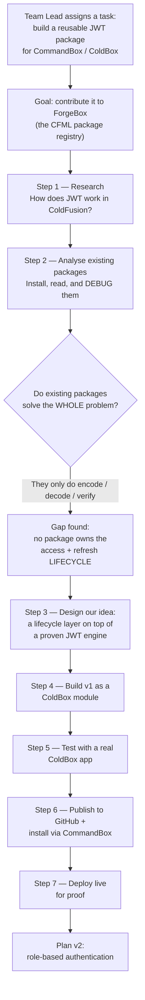

**In plain words:** our team lead (from the ColdFusion team) asked us to create a Proof of Concept
for a JWT token package that works through CommandBox/ColdBox, with the intention of adding our
contribution to ForgeBox. We started by researching how JWT works in ColdFusion, then we analysed
and **debugged the JWT packages that already exist** to understand exactly what they do and where
they stop. That research is what led us to the idea for this package.

---

## 3. Research — What We Learned About JWT in ColdFusion

*(Summarised from our internal “Research Notes – JWT in ColdFusion (POC Preparation)”.)*

### 3.1 The three ways to make a JWT in ColdFusion

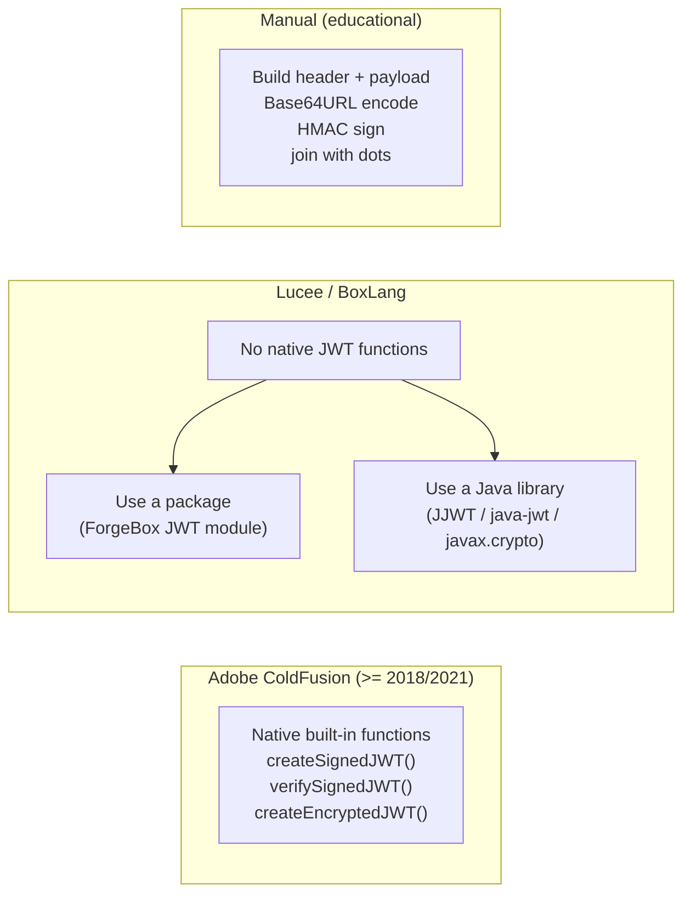

**Key findings from the research:**

| Topic | What we found |
| --- | --- |
| **Adobe native support** | Adobe CF ships `createSignedJWT()`, `verifySignedJWT()`, `createEncryptedJWT()`. The developer supplies the *payload + algorithm + secret*; ColdFusion builds the header, JSON, Base64URL encoding, and signature automatically. **No install needed — but Adobe-only.** |
| **Lucee / BoxLang** | Have **no native JWT functions**. They must use a **package** or a **Java library**. Because a JAR runs on any JVM, a **Java-library approach works on every engine**. |
| **Old package approach** | Before native support, developers did `box install jwt-cfml`, then `new JWTService().encode(payload, secret)`. Still low-level. |
| **Manual approach** | Understood JWT internals: `base64UrlEncode(header) . base64UrlEncode(payload) . HMAC-signature`. Good for learning; nobody should hand-roll this in production. |
| **Signed vs Encrypted** | **Signed** = payload is *visible* but *tamper-proof*. **Encrypted** = payload is *hidden*. For authentication tokens, **signed** is the standard (and what we implement). |
| **Standard claims** | `iss`, `sub`, `aud`, `exp`, `iat`, `nbf`, `jti`. |

### 3.2 The decision that came out of research

Because we needed **one package that behaves identically on Adobe CF, Lucee, and BoxLang**, we
chose the **Java-library route** for signing (`javax.crypto`) rather than Adobe's engine-specific
native functions. A JAR is a JAR on every JVM — so the signature bytes are the same everywhere.

---

## 4. The Gap We Found & Our Idea

### 4.1 The gap

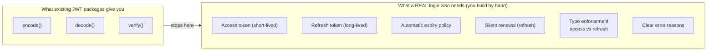

Plenty of JWT packages exist on ForgeBox, but they are **low-level engines** — they produce and
verify a *single* token and stop. The **access-token + refresh-token pattern** that *every* real
application needs (short-lived access token, long-lived refresh token, silent renewal, forced
logout when the refresh token dies) has to be **re-implemented by hand every single time**. There
was **no package that made this lifecycle a standard, drop-in concept**.

### 4.2 Our idea

- **Don't reinvent the crypto.** Reuse a proven JWT engine for the raw encode/decode/sign work.
- **Add a second layer on top** that owns the access & refresh *lifecycle* — `issue`, `verify`,
  `decode`, `refresh`, plus precise diagnostics.
- **Be opinionated** with safe defaults so a developer gets a correct login flow out of the box.
- **Work on all CF engines** by signing with Java.
- **Ship v1 now; add role-based authentication in v2.**

---

## 5. What Is a JWT? (Plain-English Primer)

A JWT (JSON Web Token) is a signed string with **three parts joined by dots**:

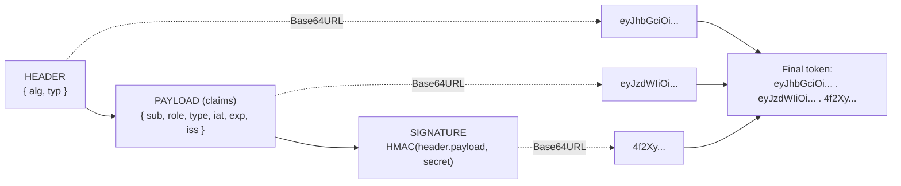

- The **header** says how it was signed (e.g. `HS512`).
- The **payload** holds the *claims* — who the user is (`sub`), their `role`, when it was issued
  (`iat`), when it expires (`exp`), who issued it (`iss`), and our custom `type` (access/refresh).
- The **signature** is an HMAC of `header.payload` using a **secret**. If anyone changes a single
  character, the signature no longer matches → the token is rejected.

**Important:** the payload is *readable by anyone* (it's just Base64), but it **cannot be changed**
without invalidating the signature. So never put passwords in it — put an id and role.

---

## 6. Package Structure

The package is a small, focused ColdBox module:

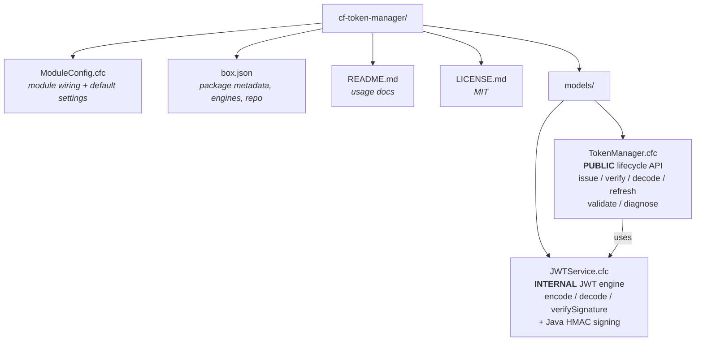

| File | Public? | Responsibility |
| --- | --- | --- |
| `models/TokenManager.cfc` | ✅ **Public** — the only thing host apps use | Access/refresh concept, expiry policy, type checking, claim stamping, precise error diagnostics |
| `models/JWTService.cfc` | 🔒 **Internal** — do not inject directly | Encode / decode / sign / verify a *single* JWT. No idea of access vs refresh |
| `ModuleConfig.cfc` | ⚙️ Config | Registers the models under the `cf-token-manager` namespace and exposes overridable settings |
| `box.json` | 📦 Metadata | Name, version, engines, keywords, GitHub repo, `"private": true` |
| `README.md` | 📖 Docs | Quick-start usage |

> **“Initial / old module” note:** we first built and tested `cf-token-manager` as a **local
> ColdBox module** living inside the host app at `lib/modules/cf-token-manager/`. Once it worked,
> we pushed it to GitHub so it could be installed as a **real package** (see
> [§13 Distribution](#13-distribution--from-local-module-to-installable-package)).

---

## 7. Architecture — The Two Layers

We deliberately split the package into **two layers** so the reusable engine and the opinionated
policy stay cleanly separated.

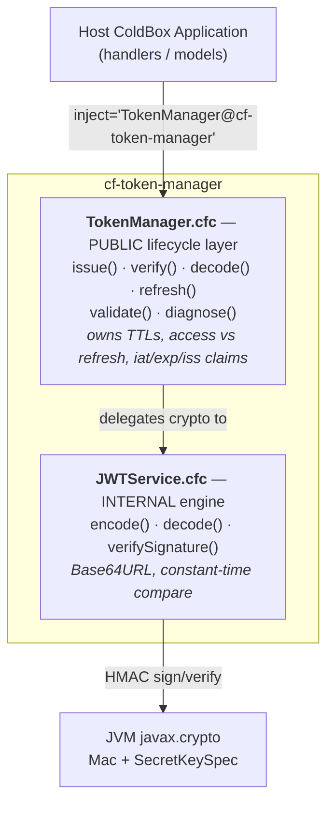

### Why two layers?

- The **engine** (`JWTService`) can be upgraded or swapped without touching application code.
- The **lifecycle layer** (`TokenManager`) encodes all the "correct behaviour" (short access
  token, long refresh token, type enforcement) so developers never repeat it.
- **Reserved control claims** (`type`, `iat`, `exp`, `iss`) are owned by the package and stripped
  from any caller-supplied data — so a caller **cannot forge** a token's type or expiry.

---

## 8. The Java Library — Why and What For

**What we use:** the JVM's built-in cryptography classes — **`javax.crypto.Mac`** and
**`javax.crypto.spec.SecretKeySpec`** — inside `JWTService.cfc`.

**Its one job:** compute the **HMAC signature** of `header.payload` using the secret, for the
`HS256` / `HS384` / `HS512` algorithms.

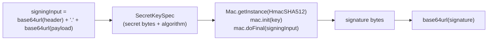

**Why Java instead of Adobe's native functions?**

| Reason | Explanation |
| --- | --- |
| **Runs on every engine** | `javax.crypto` is part of the JVM. Adobe CF, Lucee, and BoxLang all run on the JVM, so the **exact same signature bytes** are produced everywhere. Adobe's `createSignedJWT()` would only work on Adobe. |
| **No extra dependency** | These classes ship with Java itself — nothing to download, no JAR to bundle. |
| **Standard & battle-tested** | HMAC via `javax.crypto` is the industry-standard, audited implementation. |
| **Deterministic** | Same input + same secret = same signature, every time, on every engine — which is exactly what a portable token package needs. |

This single decision is *why the package is truly cross-engine.*

---

## 9. Public API Reference

Inject the manager anywhere in the host app:

```cfml
property name="tokenManager" inject="TokenManager@cf-token-manager";
```

| Function | Signature | What it does |
| --- | --- | --- |
| **issue** | `issue(struct subject)` → `{ accessToken, refreshToken }` | Mint a fresh access + refresh pair |
| **verify** | `verify(string token, string type="access")` → `boolean` | Authentic **and** unexpired **and** right type? (never throws) |
| **decode** | `decode(string token)` → `struct` | Read claims **without** verifying (use `verify()` first if you must trust it) |
| **refresh** | `refresh(string refreshToken)` → `{ accessToken }` | Exchange a valid refresh token for a new access token |
| **validate** | `validate(string token, string type)` → `struct` (throws) | Strict check that **throws a typed exception** describing exactly why a token is bad |
| **diagnose** | `diagnose(string token, string type)` → `{ valid, code, message }` | Non-throwing companion to `validate()` — perfect for clean JSON error responses |

### 9.1 `issue()`

```cfml
var tokens = tokenManager.issue( { id : 101, role : "admin", email : "a@b.io" } );
// {
//   "accessToken"  : "eyJ0eX...",   // type=access,  short-lived
//   "refreshToken" : "eyJ0eX..."    // type=refresh, long-lived
// }
```
- The `id` (or `sub`) key becomes the JWT `sub` claim.
- All other business keys (`role`, `email`, …) are carried into the token verbatim.
- Claim names are **lower-cased** for predictable behaviour across engines (Adobe CF otherwise
  upper-cases unquoted struct keys).
- Throws `cftokenmanager.InvalidSubject` if neither `id` nor `sub` is present.

### 9.2 Diagnostics — the error codes

When you need to tell the client **why** a token was rejected:

| `diagnose()` code | Thrown exception type | Meaning |
| --- | --- | --- |
| `VALID` | — | Authentic, unexpired, correct type |
| `MISSING_TOKEN` | `cftokenmanager.MissingToken` | Empty / no token supplied |
| `MALFORMED_TOKEN` | `cftokenmanager.MalformedToken` | Not a 3-segment JWT / unparseable body |
| `INVALID_SIGNATURE` | `cftokenmanager.InvalidSignature` | Signature doesn't match the secret (tampered / wrong secret) |
| `TOKEN_EXPIRED` | `cftokenmanager.ExpiredToken` | `exp` claim is in the past |
| `INVALID_TOKEN_TYPE` | `cftokenmanager.InvalidTokenType` | e.g. a refresh token used on an access endpoint |

### 9.3 Security design notes

- **Java HMAC signing** (`javax.crypto`) → identical, portable behaviour across all engines.
- **Constant-time signature comparison** mitigates timing attacks.
- **base64url** encoding (URL-safe, no padding) per the JWT spec.
- **Reserved claims** (`type`, `iat`, `exp`, `iss`) are package-owned and stripped from caller
  input → the caller can't forge token type or expiry.
- **Signature verified before claims are trusted** — `validate()` checks the signature first,
  then reads `exp`/`type`.
- Epoch timestamps are cast to a Java `long` so they serialise as plain integers (never `1.78E9`).

---

## 10. Configuration — What the Developer Controls

This is the part reviewers usually ask about: **what does the user supply, what is default, what
is changeable, and where do I change it?**

### 10.1 The settings

| Setting | Default | Changeable? | What it controls |
| --- | --- | --- | --- |
| `secret` | `cf-token-manager-default-secret-change-me` | ✅ **Must change in production** | The HMAC secret that signs every token |
| `algorithm` | `HS512` | ✅ | Signing algorithm: `HS256` / `HS384` / `HS512` |
| `accessTokenExpiry` | `900` (15 min) | ✅ | How long the **access** token lives (seconds) |
| `refreshTokenExpiry` | `2592000` (30 days) | ✅ | How long the **refresh** token lives (seconds) |
| `issuer` | `cf-token-manager` | ✅ | The `iss` claim stamped on every token |

### 10.2 Where the defaults live (the package)

`cf-token-manager/ModuleConfig.cfc` → `configure()`:

```cfml
settings = {
    secret             : "cf-token-manager-default-secret-change-me", // ALWAYS override
    algorithm          : "HS512",     // HS256 | HS384 | HS512
    accessTokenExpiry  : 900,         // 15 minutes
    refreshTokenExpiry : 2592000,     // 30 days
    issuer             : "cf-token-manager"
};
```

### 10.3 Where the developer OVERRIDES them (the host app)

In the host app's `app/config/Coldbox.cfc` → `moduleSettings`:

```cfml
moduleSettings = {
    "cf-token-manager" : {
        secret             : getSystemSetting( "JWT_SECRET", "change-me" ), // from .env
        algorithm          : "HS512",
        accessTokenExpiry  : 900,
        refreshTokenExpiry : 2592000,
        issuer             : "my-app"
    }
};
```

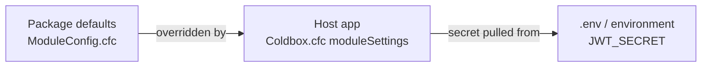

### 10.4 What is public vs private

| Public (developer touches) | Private / internal (leave alone) |
| --- | --- |
| `TokenManager.cfc` methods: `issue`, `verify`, `decode`, `refresh`, `validate`, `diagnose` | `JWTService.cfc` (the whole engine) |
| The 5 settings above | `sign()`, `base64UrlEncode()`, `constantTimeEquals()`, `normalizeSubject()`, `stripReservedClaims()`, `epochSeconds()` |
| — | Reserved claims `type`, `iat`, `exp`, `iss` (managed automatically) |

---

## 11. Developer Workflow — How Easy It Is to Use

From zero to a working login in **five short steps**:

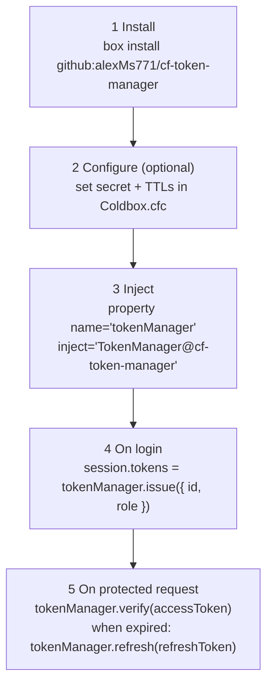

```cfml
// 1. install (adds it to box.json and downloads from GitHub)
//    box install github:alexMs771/cf-token-manager

// 2. inject the manager in any handler / model
property name="tokenManager" inject="TokenManager@cf-token-manager";

// 3. on login — mint the pair
session.tokens = tokenManager.issue( { id : username, role : "customer" } );

// 4. on a protected request — check the access token
if ( tokenManager.verify( session.tokens.accessToken ) ) {
    var claims = tokenManager.decode( session.tokens.accessToken );
}

// 5. when the access token expires — silently renew
var fresh = tokenManager.refresh( session.tokens.refreshToken );
```

That's it — the developer never touches Base64, HMAC, header building, or expiry maths.

---

## 12. How We Tested It — The Live ColdBox App

We integrated the package into a real ColdBox application (**`TestingApp`**) and exercised it in
**two complementary ways**.

### 12.1 The real authentication flow (`Security` handler + live dashboard)

This is the lifecycle exactly as a production app uses it:

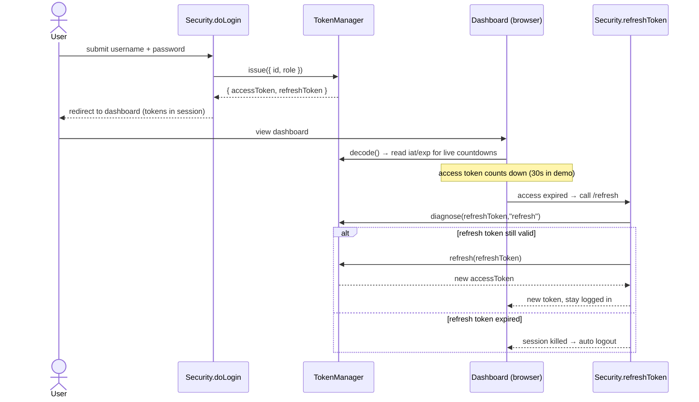

**The app logic, step by step:**
1. **Login** → `issue()` mints the first access + refresh pair, stored in the session.
2. **Dashboard** → `decode()` reads `iat`/`exp` to drive live countdown timers and progress bars.
3. **Access token expires** → the browser calls the `/refresh` JSON endpoint, which uses
   `diagnose()` to confirm the refresh token is still good, then `refresh()` to **silently mint a
   new access token** — the user stays logged in.
4. **Refresh token expires** → `diagnose()` reports it, the session is killed, and the user is
   **logged out automatically**.

**Screenshot — the login screen** (`/login`). A JWT access + refresh pair is issued on sign-in:

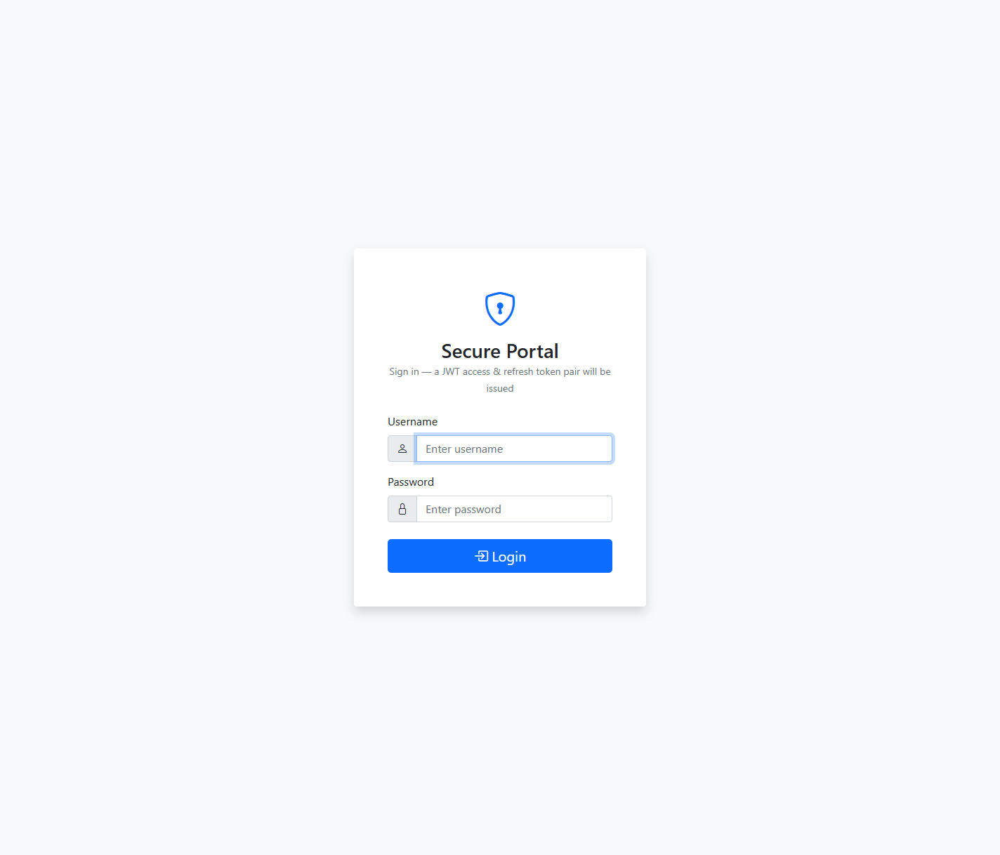

**Screenshot — the live dashboard** after logging in as `test`. The access token counts down
(here `0:27`), the refresh token holds the session (`1:57`), and both real JWT strings are shown.
When the access token hits zero the app silently calls `refresh()`:

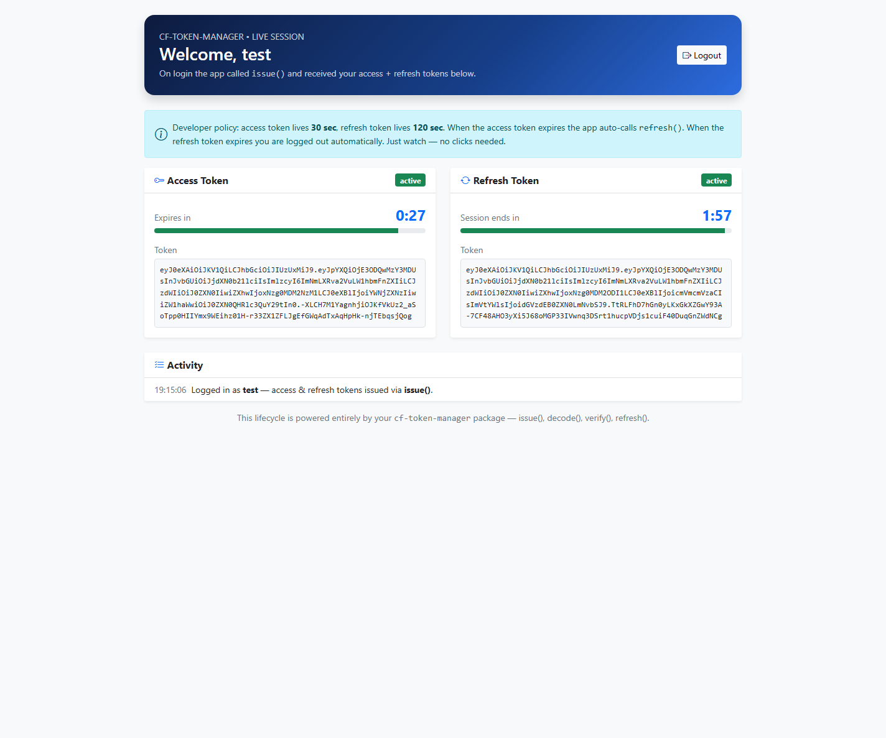

### 12.2 Timeout settings used for the demo

So the whole lifecycle is visible in **~2 minutes** during a live review, the host app uses short
TTLs in `app/config/Coldbox.cfc`:

```cfml
"cf-token-manager" : {
    accessTokenExpiry  : 30,   // access token lives 30 seconds
    refreshTokenExpiry : 120   // refresh token lives 2 minutes
}
```
*(Production values would typically be `900` / `2592000`.)* The ColdFusion **session timeout**
itself is 30 minutes (`public/Application.cfc`).

### 12.3 The automated self-test console (`/demo`)

`app/handlers/TokenDemo.cfc` renders a **self-test matrix** that runs on every page load and
reports **expected-vs-actual** for every public function across all success *and* failure modes.

| Dimension | Function(s) | Expected | Result |
| --- | --- | --- | --- |
| Mint valid pair | `issue()` | Two 3-segment JWTs | ✅ PASS |
| Reject subject with no id/sub | `issue()` | `InvalidSubject` thrown | ✅ PASS |
| Read claims without verifying | `decode()` | Claims returned | ✅ PASS |
| Valid access token | `verify()` | `true` | ✅ PASS |
| Tampered token | `verify()` / `diagnose()` | `false` / `INVALID_SIGNATURE` | ✅ PASS |
| Wrong secret | `diagnose()` | `INVALID_SIGNATURE` | ✅ PASS |
| Expired token | `diagnose()` | `TOKEN_EXPIRED` | ✅ PASS |
| Malformed token | `diagnose()` | `MALFORMED_TOKEN` | ✅ PASS |
| Missing token | `diagnose()` | `MISSING_TOKEN` | ✅ PASS |
| Wrong type (access as refresh) | `diagnose()` | `INVALID_TOKEN_TYPE` | ✅ PASS |
| Valid refresh → new access | `refresh()` | New access token is `VALID` | ✅ PASS |
| Access token used as refresh | `refresh()` | `InvalidTokenType` thrown | ✅ PASS |

**All checks pass** on page load and re-run live, so any regression is visible immediately.

**Screenshot — the live self-test console** (`/demo`) reporting **14 / 14 checks passed**, with the
full expected-vs-actual matrix and interactive `issue()` / `refresh()` / `decode()` / `verify()`
panels below it:

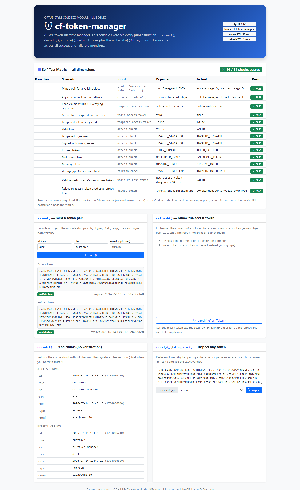

### 12.4 Test / demo routes

| Route | Maps to | Purpose |
| --- | --- | --- |
| `/login`, `/dashboard`, `/refresh`, `/logout` | `security.*` | End-to-end auth lifecycle |
| `/demo` | `tokenDemo.index` | Self-test matrix + interactive console |
| `/demo/issue` | `tokenDemo.issue` | Interactive `issue()` |
| `/demo/refresh` | `tokenDemo.refresh` | Interactive `refresh()` |
| `/demo/inspect` | `tokenDemo.inspect` | `decode()` + `verify()` + `diagnose()` on any pasted token |

**Demo credentials:** `test` / `test` and `user` / `pass`.

---

## 13. Distribution — From Local Module to Installable Package

The package grew up in three stages — this is the "it acts as a real package" story:

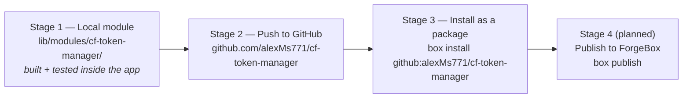

The host app's `box.json` now depends on it exactly like any real package:

```json
"dependencies" : {
    "coldbox"          : "^8.0.0",
    "cf-token-manager" : "github:alexMs771/cf-token-manager"
},
"installPaths" : {
    "cf-token-manager" : "lib/modules/cf-token-manager/"
}
```

So a fresh developer just runs **`box install`** and CommandBox pulls the package straight from
GitHub into `lib/modules/`, where ColdBox auto-discovers and loads it. The package's `box.json`
declares `"private": true` today; flipping that to `false` and running `box publish` is all that's
needed to list it on ForgeBox.

---

## 14. Deployment — Live on the Internet

The proof is public and running:

**🔗 https://jwt-testing-app.onrender.com/**

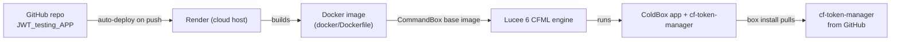

- **Host:** Render (free tier) with auto-deploy on every push to `main`.
- **Container:** a `Dockerfile` based on the official Ortus **CommandBox** image, running
  **Lucee 6** as the CFML engine — proving the package's cross-engine claim in production
  (developed on BoxLang/Adobe locally, deployed on Lucee).
- **Package:** installed during the build with `box install` straight from GitHub.

> ℹ️ On Render's free tier the instance sleeps after ~15 minutes of inactivity, so the **first**
> request after idle can take ~50 seconds to wake up. This is a hosting-plan characteristic, not a
> package behaviour.

---

## 15. Maintainability — Why This Is Easy to Keep Alive

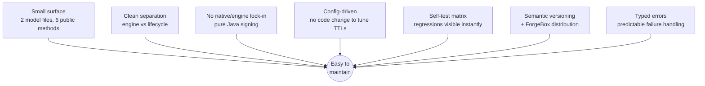

| Property | Why it helps maintenance |
| --- | --- |
| **Tiny, focused codebase** | Two model files, six public methods — a new developer understands it in one sitting. |
| **Two-layer separation** | Upgrade the crypto engine without touching app-facing code, and vice-versa. |
| **No engine lock-in** | Java signing means an engine upgrade (Adobe → Lucee → BoxLang) doesn't break tokens. |
| **Config over code** | Changing secret, algorithm, or TTLs is a settings edit — never a code change. |
| **Built-in self-tests** | The `/demo` matrix re-validates every function on each load; regressions surface immediately. |
| **Typed exceptions + diagnose codes** | Callers handle failures predictably; behaviour is documented and stable. |
| **Versioned & installable** | Semantic versioning + `box install` / ForgeBox means clean, trackable upgrades. |

---

## 16. ForgeBox Publishing Plan

ForgeBox is the CFML community's package registry (like npm for Node). A good ForgeBox listing
needs the things we've already prepared:

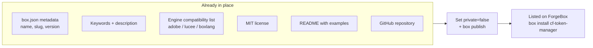

| ForgeBox requirement | Our status |
| --- | --- |
| Unique `slug` | ✅ `cf-token-manager` |
| Semantic `version` | ✅ `1.0.0` |
| `shortDescription` + `description` | ✅ Present |
| `keywords` (discoverability) | ✅ `jwt, token, authentication, access-token, refresh-token, coldbox, security` |
| `license` | ✅ MIT |
| Supported `engines` | ✅ Adobe `>=2021`, BoxLang `>=1.0.0`, Lucee `>=5.3` |
| Public `repository` | ✅ GitHub |
| Docs / README | ✅ Present |

The only remaining action is to set `"private": false` and run `box publish`.

---

## 17. Roadmap

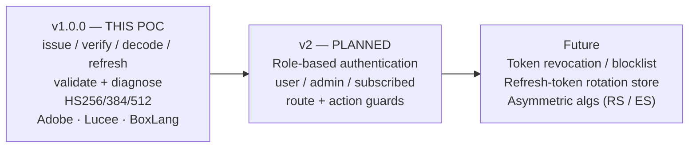

| Version | Feature set |
| --- | --- |
| **v1.0.0 (this POC)** | Access + refresh token lifecycle: `issue`, `verify`, `decode`, `refresh`, plus `validate`/`diagnose` diagnostics; configurable policy; HS256/384/512; Adobe CF / Lucee / BoxLang support. |
| **v2 (planned)** | **Role-based authentication** — first-class roles such as `user`, `admin`, and `subscribed`, with helpers to guard routes/actions by role. |
| **Future** | Token revocation / blocklist, refresh-token rotation store, asymmetric algorithms (RS/ES). |

---

## 18. Conclusion & Recommendation

This POC demonstrates that **`cf-token-manager` closes a real, verifiable gap** in the ColdFusion
ecosystem: a **standardised, developer-ready access & refresh token lifecycle** for CFML/ColdBox,
built on proven JWT primitives and portable across **all three CF engines** via Java crypto.

We proved it end-to-end:
- ✅ Every public function passes an automated **self-test matrix** across all success/failure modes.
- ✅ A **real login → dashboard → silent-refresh → auto-logout** flow works exactly as designed.
- ✅ It installs as a **real package** from GitHub (`box install github:alexMs771/cf-token-manager`).
- ✅ It is **deployed and running live** on Lucee in the cloud.

**Recommendation:** proceed to package polish and **publish v1.0.0 to ForgeBox**, then begin **v2
(role-based authentication)**.

---

## 19. Appendix — Glossary

| Term | Meaning |
| --- | --- |
| **JWT** | JSON Web Token — a signed, self-contained token carrying user claims |
| **Access token** | Short-lived token sent on every request to prove who you are |
| **Refresh token** | Long-lived token used only to get a new access token when it expires |
| **Claim** | A piece of data inside the token (e.g. `sub`, `role`, `exp`) |
| **HMAC** | Hash-based Message Authentication Code — the signing method (`HS256/384/512`) |
| **Secret** | The private key used to sign/verify tokens; must be kept safe |
| **CommandBox** | The CLI for CFML — package manager + server runner |
| **ColdBox** | The MVC framework for CFML applications |
| **ForgeBox** | The CFML package registry (like npm for ColdFusion) |
| **Module** | A self-contained, installable ColdBox component |
| **CFML** | ColdFusion Markup Language — runs on Adobe CF, Lucee, and BoxLang |

---

*POC prepared by the JWT package team. Package tested with the `TestingApp` ColdBox application
and deployed live on Lucee 6 via CommandBox + Docker on Render.*